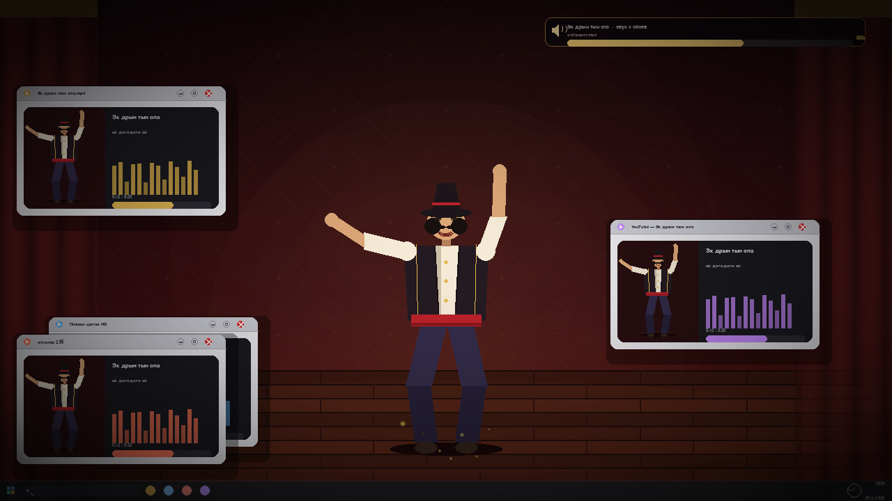
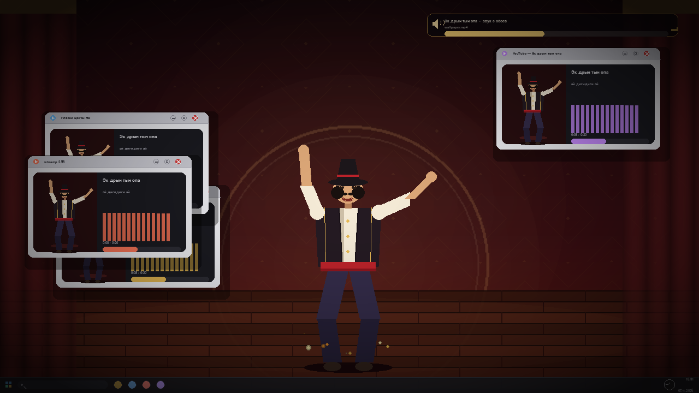
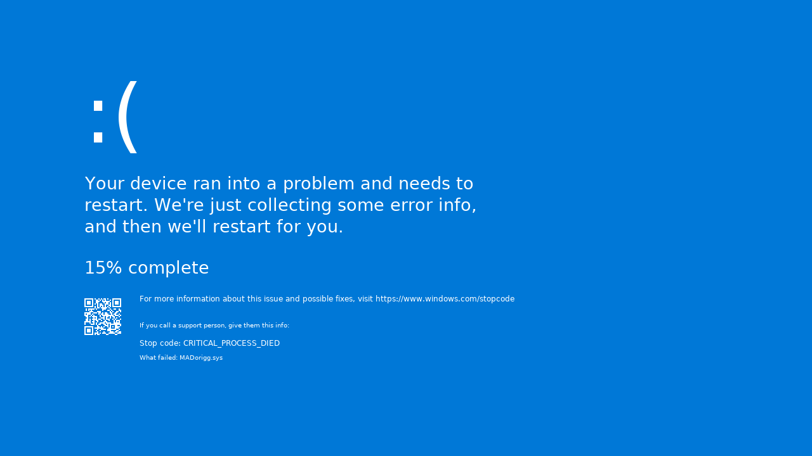
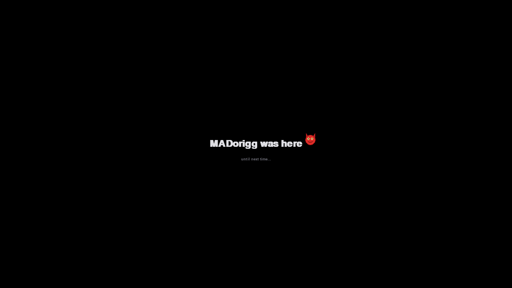

# MADorigg 😈 — обои, которые поют

Десктопный пранк на **Python + pygame**: приложение разворачивается на весь экран
поверх всех окон и притворяется рабочим столом. Обои «оживают»: на них выходит
мужик в шляпе и начинает танцевать под цыганскую песню **«Эк дрын тын опа»** —
музыка идёт прямо из обоев, из стены расходятся звуковые круги. Через пару секунд
по экрану начинают летать **четыре окна-плеера** с этой же песней и тем же мужиком.
Крестик у окон не работает — они не закрываются, а просто отскакивают с подписью
«не закроешь :)». Песня длится **20 секунд**, после чего система «умирает»:
**фейковый синий экран смерти на 10 секунд**, чёрный экран — и всё исчезает само.

Ни одного внешнего ассета: **вся музыка, все звуки, обои, танцор и окна создаются
кодом** (numpy-синтез + `pygame.draw`). После финала громкость, курсор и экран
возвращаются ровно в исходное состояние.


### Кадры шоу

[](docs/gallery.png)

| | |
|---|---|
|  |  |
|  |  |

Кадры сняты автоматически (`--capture`) в реальном рендере 1280×720; в игре всё
это анимировано на 60 FPS. Классический режим со смайликами — в
[`docs/screenshots/classic/`](docs/screenshots/classic).

> ⚠️ **Это пранк-приложение.** Громкость выкручивается до 100 %, экран перехватывается
> на ~34 секунды, а на время шоу блокируются `Alt+Tab`, `Win`, `Ctrl+Esc` и `Alt+Esc`
> (см. раздел 5). Запускай только на своей машине или с явного согласия владельца.
> Аварийный выход — **удерживать `Esc` 2 секунды** (прогресс-бар внизу экрана).
> `Ctrl+Alt+Del` не перехватывается никогда; громкость восстанавливается в любом случае.

---

## 1. Что происходит

| Время | Фаза | События |
|-------|------|---------|
| 0–0.9 с | **Появление обоев** | Borderless fullscreen + topmost, системная громкость → 100 %, картинка проявляется из темноты, стартует песня |
| 0.9–20 с | **Живые обои** | Мужик в шляпе танцует на досках: присядка, выпады, вращение, хлопки над головой; от стены идут звуковые круги, на каждый бит — искры из-под сапог; сверху медиа-плашка «звук с обоев»; внизу настоящая панель задач с часами |
| 1.4–4 с | **Окна-плееры** | Одно за другим вылетают 4 окна: «Эк дрын тын опа.mp4», «Пляски цыган HD», «winamp 2.95», «YouTube — Эк дрын тын опа» — в каждом свой мини-мужик, эквалайзер и прогресс-бар песни. Летают по экрану, отскакивают от краёв и облетают танцора |
| всё время | **Крестик не работает** | Клик по `X` — окно отпрыгивает, трясётся и показывает «не закроешь :)»; закрыть нельзя, они исчезнут сами |
| 20–30 с | **Фейковый краш** | Песня обрывается, кадр «зависает» → настоящий на вид синий экран Windows 11: `#0078D7`, Segoe UI, `:(`, `NN% complete` **шагами по 5 %**, белый QR, `Stop code: CRITICAL_PROCESS_DIED`, `What failed: MADorigg.sys` — ровно **10 секунд** |
| 30–34 с | **Очистка** | Чёрный экран как при перезагрузке, громкость возвращается, курсор возвращается, «MADorigg was here» — обои и окна пропадают, приложение закрывается |

Цветовые палитры, длительности и лимиты живут в [`config.py`](config.py).
Классическое шоу со смайликами запускается флагом `--classic` (см. ниже).

---

## 2. Быстрый старт (Windows 10/11, Python 3.11+)

```bat
cd MADorigg
python -m venv .venv
.venv\Scripts\activate
pip install -r requirements.txt
python main.py
```

Или просто двойной клик по **`run.bat`** — он сам создаст venv, поставит зависимости
и запустит шоу.

### Полезные флаги

```bat
python main.py                            :: обои с танцором + BSOD (по умолчанию)
python main.py --classic                  :: старое шоу: битва красного и синего смайликов
python main.py --windowed                 :: в окне 1280x720 (для разработки)
python main.py --no-lock                  :: НЕ блокировать Alt+Tab / Win (безопасный режим)
python main.py --no-death                 :: без фейкового синего экрана
python main.py --limit 120                :: аварийный выход через N секунд (по умолчанию 180)
python main.py --no-volume                :: не трогать системную громкость
python main.py --no-audio                 :: вообще без звука
python main.py --time-scale 20            :: ускоренная «сухая» прогонка (34 с -> 2 с)
python main.py --seed 42                  :: детерминированный рандом
python main.py --capture frames           :: сохранять PNG-кадры в frames/
python main.py --self-delete              :: удалить .exe после шоу (только frozen-сборка)
python main.py --log-level DEBUG          :: подробный лог
```

`--time-scale` — множитель скорости: `20` — быстро, `0.5` — медленно, `1.0` — как задумано.

---

## 3. Структура проекта

```
MADorigg/
├── main.py                    # точка входа, CLI, finally-восстановление
├── config.py                  # все константы: тайминги, цвета, лимиты
├── requirements.txt
├── run.bat                    # one-click запуск
├── audio/
│   ├── volume_control.py      # pycaw: save / fade / restore + snapshot mute
│   ├── sound_generator.py     # numpy-синтез: бас, бочка, взрывы, гонг, музыка
│   └── music_player.py        # микшер, EQ, троттлинг эффектов, авто-громкость
├── visuals/
│   ├── screen.py              # fullscreen/topmost, DPI, скрытие курсора, shake
│   ├── particles.py           # Particle + ParticleSystem, пресеты (огонь/лёд/конфетти)
│   ├── effects.py             # Flash, ScreenShake, Glitch, Vignette
│   ├── wallpaper.py           # обои: градиент, орнамент, шторы, доски, прожектор, круги
│   ├── background.py          # (classic) красный/синий градиенты, молнии, пол арены
│   └── text_renderer.py       # шрифты, кеш, глитч/пульс, авто-фильтр emoji
├── entities/
│   ├── dancer.py              # танцующий цыган: шляпа, усы, жилет, присядка, вращение
│   ├── fake_window.py         # окна-плееры: хром, крестик-обманка, мини-танцор, эквалайзер
│   ├── boss.py                # (classic) два босса-смайлика, анимации, телеграф атак
│   ├── soldier.py             # (classic) человечки scout/regular/brute
│   ├── projectile.py          # (classic) фаербол, ледяной луч, мега-атака
│   └── army.py                # (classic) спавн волн, пул солдат, статистика
├── battle/
│   ├── battle_manager.py      # BattleContext (canvas, эффекты, таймер), HUD, фазы
│   ├── collision.py           # пространственный хэш, бои, попадания снарядов
│   ├── front_line.py          # зигзагообразная линия фронта
│   └── kiosk.py               # Windows-хук: блокировка Alt+Tab/Win, watchdog фокуса
├── phases/
│   ├── phase_gypsy.py         # 1: живые обои, танцор, 4 летающих окна, панель задач
│   ├── phase_death.py         # 2: фейковый синий экран смерти, 10 секунд
│   ├── phase_cleanup.py       # 3: fade, восстановление, подпись
│   ├── phase_intro.py         # (classic) 0–1: чернота, громкость, вспышка, логотип
│   ├── phase_bosses.py        # (classic) 2: раскол экрана, выход боссов
│   ├── phase_battle.py        # (classic) 3: битва
│   └── phase_finale.py        # (classic) 4: победитель, мега-атака, победа
├── tools/
│   ├── smoke_test.py          # headless-прогон всего шоу + docs/preview.png
│   ├── make_icon.py           # assets/icon.ico без Pillow
│   ├── build_exe.py           # PyInstaller-сборка
│   └── build_exe.bat          # one-click сборка .exe
├── assets/icon.ico
└── docs/preview.png
```

---

## 4. Как это устроено

* **`BattleContext`** — общий объект кадра: offscreen-canvas, часы, RNG, частицы,
  эффекты, армии, боссы, снаряды, линия фронта, статистика. Каждая фаза получает
  его и крутит собственный цикл: `dt = ctx.begin_frame()` → симуляция → отрисовка →
  `ctx.present()`.
* **Обои** (`visuals/wallpaper.py`) — статические слои считаются один раз: бордовый
  градиент, золотая ромбовидная решётка, шторы по краям, деревянный пол с досками,
  прожектор и звуковое кольцо. На кадре остаётся только пульсация по биту и кольца,
  которые «выходят из стены» — визуально песня звучит именно из обоев.
* **Танцор** (`entities/dancer.py`) — фигура целиком из `pygame.draw`: шляпа, усы,
  жилет с золотой отделкой, кушак, шаровары, сапоги. Поза считается по номеру бита
  и фазе внутри него: выпад влево, выпад вправо, присядка, вращение (сжатие по X),
  плюс махи руками и хлопки над головой на каждом втором бите.
* **Окна** (`entities/fake_window.py`) — настоящий хром Win10 (заголовок, кнопки
  свернуть/развернуть/закрыть), внутри — мини-танцор, название трека, эквалайзер и
  прогресс-бар. Летают с постоянной скоростью, отскакивают от краёв, обходят
  прямоугольник сцены и не дают себя закрыть: `X` вызывает `refuse()`.
* **Песня** (`generate_gypsy_theme`) — 20 секунд, 12 тактов по 4/4 при 150 BPM,
  D гармонический минор (Dm–Gm–A7–Dm). Скрипка с вибрато (пила + формантный шум),
  цимбалы (затухающие гармоники), контрабас, бубен восьмыми, хлопки на 2 и 4 и
  крик «ОПА!» в конце каждой фразы — всё синтезировано в numpy.
* **Отрисовка в canvas + blit со смещением** — так работает screen shake без
  пересчёта мира. Glitch и vignette накладываются на canvas, flash — уже на окно.
* **Звук**: `sound_generator` рендерит банк эффектов и три музыкальных темы
  (цыганская, боевая, победная) примерно за секунду. `music_player` вешает EQ +12 дБ низа / +6 дБ верха, держит
  отдельный канал под музыку и троттлит однотипные эффекты, чтобы 200 столкновений
  в секунду не превращались в белый шум.
* **Солдаты (режим `--classic`)**: `Army` спавнит волны (6–10 бойцов каждые 0.5 с на сторону, максимум
  120 живых); около половины сразу выходит на линию фронта, остальные бегут от края. Столкновения считаются через хэш по `x` с шагом
  48 px, пары перемешиваются и разрешаются 50/50 — битва честная независимо от
  порядка обхода.
* **Смерть** считается один раз в `Army.update()` (`Stats.record_death`), поэтому
  в HUD сходятся любые причины: бой, фаербол, разбившийся лёд, финальный залп.
* **Глитч**: сдвиг горизонтальных полос + RGB-расщепление дорогими копиями
  поверхности — включается только на 0.12–0.25 с, поэтому 60 FPS не страдает.
* **HUD** — полноценное табло: счёт армий, убийства, полоса перевеса с маркером
  линии фронта, номер волны и таймер; цифры пульсируют в такт музыке.
* **Кинематографичное время** — `ctx.hitstop()` замирает на 50–80 мс на попадании,
  `ctx.slowmo()` замедляет финальный залп; время эффектов идёт отдельно от реального.
* **Фейковый BSOD** (`phase_death.py`) — правдоподобность в деталях: точный
  цвет Windows `#0078D7`, настоящий **Segoe UI Light** из `C:\Windows\Fonts`,
  раскладка с реального скриншота (в процентах от высоты экрана), проценты
  только кратными пяти, белые модули QR-кода, полная тишина и отсутствие любой
  пост-обработки — ни виньетки, ни зерна, ни глитча. Рисуется кодом целиком.
* **Emoji-фильтр**: `pygame.font` на Windows не умеет цветные emoji, поэтому
  `TextRenderer.sanitize()` проверяет `font.metrics()` и выкидывает символы,
  которых нет в шрифте (вместо «тофу»-квадратиков).

---

## 5. Безопасность: что и как восстанавливается

| Ресурс | Сохранение | Восстановление |
|--------|-----------|----------------|
| Системная громкость | `VolumeControl.save_volume()` до старта | `finally` в `main.py` + `phase_cleanup` (плавно, 1 с) |
| Mute-флаг | вместе с громкостью | `restore_volume()` |
| Эквалайзер | `EqualizerState` | см. ниже |
| Курсор | `set_cursor_visible(False)` | `finally` + cleanup |
| Окно | fullscreen/topmost | `pygame.quit()` в `finally` |

* **`Esc` / `Alt+F4` / закрытие окна** → `ScenarioAbort` → `finally` → громкость,
  курсор и микшер восстанавливаются, код возврата 0.
* **Любое исключение** внутри шоу → `except` + `finally` → то же самое, код 1.
  Это проверено тестом (`tools/smoke_test.py` и отдельный crash-тест).
* **Эквалайзер**: Windows Core Audio API не отдаёт сторонним процессам настройки
  системного эквалайзера. Поэтому MADorigg **не меняет системный EQ** — кривая
  +12 дБ / +6 дБ применяется только к собственному аудио-потоку (FFT-шелфы в
  `sound_generator.apply_eq`), а `EqualizerState` фиксирует нейтральный baseline.
* **`--self-delete`** удаляет только замороженный `.exe` (через отложенный
  `cmd`-скрипт). Исходники `main.py` не удаляются никогда. По умолчанию выключено.

### 5.1. Киоск-режим: почему не срабатывает Alt+Tab

`battle/kiosk.py` ставит низкоуровневый хук клавиатуры (`WH_KEYBOARD_LL`) и съедает
`Tab`, `Win`, `Ctrl+Esc`, `Alt+Esc` и `Alt+Tab` — переключиться на другое окно не
получится. Плюс watchdog каждые 250 мс возвращает фокус и `TOPMOST` окну шоу, а
курсор зажимается в пределах экрана. `Alt+F4` намеренно **не** блокируется, чтобы
шоу всегда можно было штатно закрыть.

| Что | Поведение |
|-----|-----------|
| `Alt+Tab`, `Win`, `Ctrl+Esc`, `Alt+Esc` | блокируются хуком |
| `Alt+F4` | работает — штатный выход с восстановлением громкости |
| `Esc` (удерживать 2 с) | **аварийный выход**: прогресс-бар внизу, затем штатное восстановление |
| `Ctrl+Alt+Del` | **никогда не перехватывается** — всегда доступно (системный экран безопасности Windows) |
| `--no-lock` | полностью отключает хук (для тестов и для запуска «по-доброму») |
| `--limit N` | аварийный таймер: через N секунд всё восстанавливается и процесс завершается |

Хук работает только под Windows; на Linux/macOS `KioskLock` — пустышка, и шоу
отлаживается как обычное окно.

---

## 6. Сборка `MADorigg.exe`

В репозитории нет бинарника (артефакты сборки в `.gitignore`), но есть два
готовых пути. PyInstaller **не умеет кросс-компиляцию**, поэтому собрать `.exe`
можно только на Windows.

**Вариант A — локально:**

```bat
cd MADorigg
tools\build_exe.bat
```

Скрипт поставит зависимости и PyInstaller, сгенерирует иконку и положит результат
в `dist\MADorigg.exe` (один файл, без консоли, с иконкой).

**Вариант B — GitHub Actions (без Windows-машины):**

Workflow [`.github/workflows/madorigg-exe.yml`](../.github/workflows/madorigg-exe.yml)
запускается вручную (`Actions → Build MADorigg.exe → Run workflow`) или по тегу
`madorigg-v*`, собирает exe на `windows-latest`, прогоняет headless smoke-тест и
прикладывает `MADorigg.exe` в артефакты (а для тега — в Release).

Запуск собранного файла:

```bat
MADorigg.exe                  :: полное шоу
MADorigg.exe --no-volume      :: без изменения громкости
MADorigg.exe --windowed       :: в окне
```

> Антивирус может ругаться на one-file PyInstaller — это типичный false positive.
> Если нужно, собирай `--onedir` (убери `--onefile` в `tools/build_exe.py`).

---

## 7. Тестирование

```bash
# полный headless-прогон (без окна и звука) + генерация docs/preview.png
python tools/smoke_test.py

# быстрый прогон в 20 раз быстрее реального времени
python main.py --windowed --no-audio --no-volume --time-scale 20 --seed 7

# проверка банка звуков отдельно
python -c "from audio.music_player import MusicPlayer; m=MusicPlayer(); m.preload(); print(len(m.sounds))"
```

`tools/smoke_test.py` проверяет, что все пять фаз отрисовались (по именам кадров
`frame_XXXX_<phase>.png`), и собирает мозаику `docs/preview.png`.

---

## 8. Траблшутинг

| Симптом | Причина / решение |
|---------|-------------------|
| Нет звука | проверь устройство вывода; запусти с `--log-level DEBUG`, в логе будет `Mixer unavailable` |
| Громкость не меняется | нужен Windows + `pycaw`; на Linux/macOS управление громкостью отключается автоматически |
| `ModuleNotFoundError: pycaw` | `pip install -r requirements.txt` внутри активированного venv |
| Fullscreen не открылся | приложение само падает в окно 1280×720; для отладки используй `--windowed` |
| Текст «квадратиками» | в системе нет шрифта с кириллицей; поставь Arial/DejaVu (обычно есть всегда) |
| Низкий FPS | закрой тяжёлые приложения; шоу рассчитано на 60 FPS при 1920×1080 |
| Хочу тише | `--no-volume` + `MASTER_VOLUME` в `config.py`, либо `--no-audio` |

---

## 9. Стек

`Python 3.11+` · `pygame 2.5.2` · `numpy 1.26.4` · `pycaw 20240210` · `comtypes 1.4.1` ·
`ctypes` (topmost, DPI awareness, self-delete) · `threading` (плавная громкость).

## 10. Этика

Проект существует как демонстрация процедурной графики/звука и как безобидный
(но громкий) розыгрыш. Не запускай его на чужих машинах без разрешения: внезапный
полноэкранный захват и 100 % громкости — плохая шутка для незнакомого человека.
