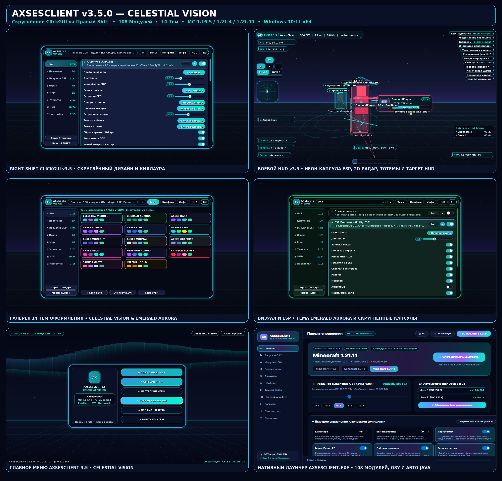

# AXSESCLIENT v3.5.0 — CELESTIAL VISION

**Нативный Windows 10/11 x64 лаунчер (`AXSESCLIENT.exe`) и Fabric-клиент для Minecraft `1.16.5`, `1.21.4` и `1.21.11` (Скруглённое ClickGUI на Правый Shift • 108 реальных модулей • 14 тем • Русский / English).**

## Скачать готовый релиз (`axsesclient-v3.5.0`)
🔗 **GitHub Release:** https://github.com/egorbelovziiik-design/WinLauncher/releases/tag/axsesclient-v3.5.0

| Файл | Размер | Назначение |
|---|---|---|
| `AXSESCLIENT-Setup.exe` | `41,826,880` байт | Официальный установщик Windows 10/11 x64 (Inno Setup 6, безопасное обновление без удаления миров и скриншотов) |
| `AXSESCLIENT.exe` | `45,576,969` байт | Автономный нативный лаунчер C# / .NET 8 / Avalonia 11 (прямой запуск игры, честное выделение `-Xmx` ОЗУ, авто-установка Java 8 и Java 21) |
| `AXSESCLIENT-1.16.5.jar` | `481,493` байт | Fabric-мод клиента для **Minecraft 1.16.5** (Java 8 bytecode `v52`) |
| `AXSESCLIENT-1.21.4.jar` | `488,733` байт | Fabric-мод клиента для **Minecraft 1.21.4** (Java 21 bytecode `v65`) |
| `AXSESCLIENT-1.21.11.jar` | `490,191` байт | Fabric-мод клиента для **Minecraft 1.21.11** (Java 21 bytecode `v65`) |

## Ключевые обновления `v3.5.0 (CELESTIAL VISION)`
- **Скруглённое меню на Правый Shift (`AXSES 3.5 • VISION`, `686×410`, радиус `20px`)**:
  - Настоящие круговые скругления углов и боков (`drawRoundedOutline` с попиксельными дугами без ступенчатых квадратных углов), светящиеся боковые неоновые грани, парящая шапка (`14px`) и боковая панель (`14px`), капсульные переключатели, ползунки и строка поиска.
  - **14 встроенных тем оформления** в удобной 3-колоночной сетке, включая новые **`CELESTIAL VISION`** и **`EMERALD AURORA`**.
- **108 рабочих модулей — улучшены все категории и добавлены 6 новых функций**:
  - **Мини-Радар 2D (`2D PvP Radar`)** — вращающийся скруглённый радар ближайших игроков и целей с компасом `С` и конусом обзора.
  - **Счётчик тотемов (`Totem Counter`)** и **Геплы и перлы (`Gapple & Pearl Tracker`)** — живой подсчёт расходников в инвентаре и левой руке с уведомлением о сносе тотема.
  - **Индикатор урона 3D (`Damage Indicators 3D`)** — всплывающие в 3D-пространстве цифры урона и исцеления (`-3.6 ❤`).
  - **Тревога низкого ХП (`Low HP Alert`)** и **Страж смерти (`Auto Death Guard`)**.
  - **КиллАура v3.5 (`FunTime` / `ReallyWorld` / `HolyWorld`)** с вращающимися **3D Сферами душ**, двойным кольцом цели и индикатором крита **`⚡КРИТ`**.
  - **ESP Подсветка v3.5** с новым режимом **`Неон-капсула`**, полосками здоровья и прочности брони, а также **3D-маяками меток и точки смерти**.
