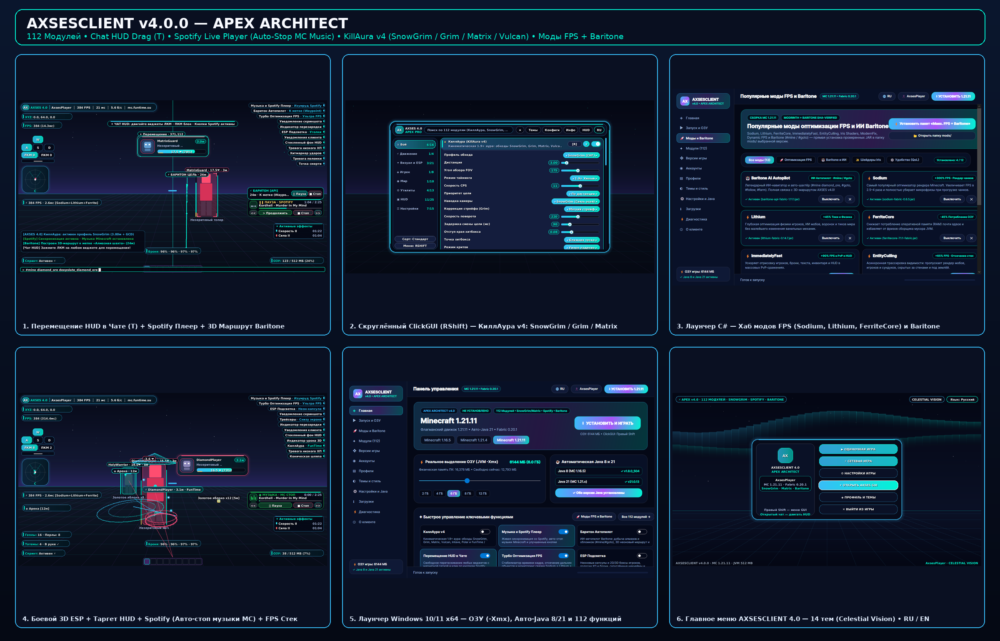

# AXSESCLIENT v4.0.0 — APEX ARCHITECT

**Нативный Windows 10/11 x64 лаунчер (`AXSESCLIENT.exe`), менеджер популярных модов (`Sodium` / `Lithium` / `Baritone`) и Fabric-клиент для Minecraft `1.16.5`, `1.21.4` и `1.21.11` (112 рабочих модулей • Перемещение HUD в Чате • Плеер Spotify • КиллАура v4 `SnowGrim`/`Grim`/`Matrix` • 14 тем • RU/EN).**

## Скачать готовый релиз (`axsesclient-v4.0.0`)
🔗 **GitHub Release:** https://github.com/egorbelovziiik-design/WinLauncher/releases/tag/axsesclient-v4.0.0

| Файл | Размер | SHA-256 | Назначение |
|---|---|---|---|
| `AXSESCLIENT-Setup.exe` | `41,931,002` байт | `e14f2605533154817c9590b10f3acf5a8cad60232b0ec6abde3f4091191dd119` | Официальный установщик Windows 10/11 x64 (Inno Setup 6, безопасное обновление без удаления миров и настроек) |
| `AXSESCLIENT.exe` | `45,593,352` байт | `16c55f609aa65449e288e21a755e95acfbffd9d49e9ba4b3be8987b6b0431bdf` | Автономный нативный лаунчер C# / .NET 8 / Avalonia 11 (прямой запуск игры, Хаб модов + Baritone, честное `-Xmx` ОЗУ, авто-Java 8 и 21) |
| `AXSESCLIENT-1.16.5.jar` | `529,405` байт | `feb5ca60137cbccfca31de844fef4eaf516ab07f1b4386c5da7ba5b59d443026` | Fabric-мод клиента для **Minecraft 1.16.5** (Java 8 bytecode `v52`) |
| `AXSESCLIENT-1.21.4.jar` | `537,103` байт | `3831fca6ef79848435ee11f0a550b273629be6b6d020d0f6718c53a98020961f` | Fabric-мод клиента для **Minecraft 1.21.4** (Java 21 bytecode `v65`) |
| `AXSESCLIENT-1.21.11.jar` | `538,635` байт | `f72961a8dd8b0bbc39b8dc7b9587384d7970d7d8cbfce0997c7a35ffdeced19c` | Fabric-мод клиента для **Minecraft 1.21.11** (Java 21 bytecode `v65`) |

## Ключевые обновления `v4.0.0 (APEX ARCHITECT)`
- **Свободное перемещение HUD прямо в Чате (`T`)**:
  - Зажмите **ЛКМ** на любом HUD-виджете прямо при открытом чате, чтобы переместить его с магнитной центровкой по осям и автосохранением позиции; **ПКМ** закрепляет/разблокирует виджет.
  - Интерактивные кнопки плеера **Spotify** и **Baritone** кликабельны прямо из открытого чата и редактора HUD без открытия лишних меню.
- **Живой плеер Музыки и Spotify (`spotify_music_hud`)**:
  - Асинхронный мост `MediaSessionBridge` определяет активный процесс/трек **Spotify** на ПК, **автоматически останавливает фоновую музыку Minecraft** (`SoundManager` / `MusicManager`), чтобы треки не накладывались друг на друга, и предоставляет тактильные кнопки **`> Продолжить`**, **`|| Пауза`**, **`■ Стоп`**, **`<<`** и **`>>`**.
- **КиллАура v4 (`SnowGrim` • `Grim` • `Matrix` • `Vulcan` • `Intave` • `Polar` • `FunTime` / `RW` / `HW`)**:
  - Новая кинематика связанных осей **Lissajous (`SnowGrim Связь осей`)**, квантование шага мыши **GCD**, задержка переключения целей (`switch_delay`), отступ края хитбокса (`hitbox_margin`) и режимы коррекции стрейфа под современные античиты.
- **Хаб популярных модов FPS и ИИ Baritone в лаунчере + в игре**:
  - Новая вкладка **«🚀 Моды и Baritone»** в `AXSESCLIENT.exe` скачивает напрямую с официального API Modrinth v2 и релизов Baritone (с проверкой **SHA-512 / SHA-1** и заголовка JAR) **12 лучших модов**: **Baritone AI Autopilot**, **Sodium**, **Lithium**, **FerriteCore**, **ImmediatelyFast**, **EntityCulling**, **Iris Shaders**, **ModernFix**, **Dynamic FPS**, **Mod Menu**, **Zoomify** и **Fabric API**, включая пакетную кнопку **«Установить пакет Макс. FPS + Baritone»**.
  - В клиенте добавлены модули **«Баритон Автопилот»** (`#mine`, `#goto`, `#stop` + 3D неоновый маршрут к цели) и **«Турбо Оптимизация FPS»** с детектором активной связки `[Sodium+Lithium+Ferrite]`.
