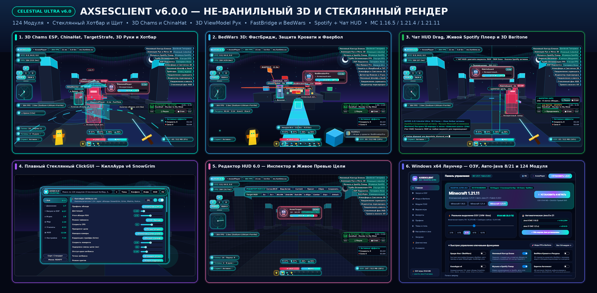

# AXSESCLIENT v6.0.0 — CELESTIAL HYPERION ULTRA

**Нативный Windows 10/11 x64 лаунчер (`AXSESCLIENT.exe`), менеджер популярных модов (`Sodium` / `Lithium` / `Baritone`) и полностью не-ванильный 3D/стеклянный Fabric-клиент для Minecraft `1.16.5`, `1.21.4` и `1.21.11` (124 рабочих модуля • Кастомный стеклянный 9-слотовый Хотбар и жидкие шкалы ХП/Щита • Объёмные 3D Volumetric Chams • 3D ViewModel и анимации меча • Таргет Стрейф 3D • ФастБридж и BedWars ESP • Перемещение HUD в Чате • Плеер Spotify • КиллАура v4 `SnowGrim`/`Grim`/`Matrix` • 14 тем • RU/EN).**

## Скачать готовый релиз (`axsesclient-v6.0.0`)
🔗 **GitHub Release:** https://github.com/egorbelovziiik-design/WinLauncher/releases/tag/axsesclient-v6.0.0

| Файл | Размер | SHA-256 | Назначение |
|---|---|---|---|
| `AXSESCLIENT-Setup.exe` | `42,068,265` байт | `9f0520093dbcb89d9360ba500bfa470702aa2855ec2791ca45c7bdda2e38f09d` | Официальный установщик Windows 10/11 x64 (Inno Setup 6, безопасное обновление без удаления миров и настроек) |
| `AXSESCLIENT.exe` | `45,593,348` байт | `77fb091c21c5fa79a21920385f05f1f599844ccf517fea1b3a02adedfeae0318` | Автономный нативный лаунчер C# / .NET 8 / Avalonia 11 (прямой запуск игры, Хаб модов + Baritone, честное `-Xmx` ОЗУ, авто-Java 8 и 21) |
| `AXSESCLIENT-1.16.5.jar` | `603,585` байт | `b7883f99924cacd7dc4b7745237f57c6a9fc32cd9188a67df2a869d97d829f2b` | Fabric-мод клиента для **Minecraft 1.16.5** (Java 8 bytecode `v52`) |
| `AXSESCLIENT-1.21.4.jar` | `610,778` байт | `84dbf76a2e28f6f796d297d50913b094d3e7ab93d4b6c15eb26a00265f600e85` | Fabric-мод клиента для **Minecraft 1.21.4** (Java 21 bytecode `v65`) |
| `AXSESCLIENT-1.21.11.jar` | `612,325` байт | `a8e53dcfaa6f82d8443d9fd20e6c49736fed929b4858f7bae3d60ca3ab9a744c` | Fabric-мод клиента для **Minecraft 1.21.11** (Java 21 bytecode `v65`) |

## Что кардинально переработано в `v6.0.0 (CELESTIAL HYPERION ULTRA)`
- **Полный отказ от плоского и «ванильного» интерфейса (`Celestial Frosted Glass` + `Vector Icons`)**:
  - Все HUD-элементы переведены на многослойные капсулы матового обсидианового стекла с 3-проходным неоновым свечением, верхним зеркальным бликом, двухцветными градиентными SDF-рамками и встроенными векторными значками.
  - **Dynamic-Island Watermark** (`AXSES 6.0` + ник + чип FPS + пинг + скорость + сервер), **стеклянный ArrayList** со светящимися бейджами режимов и неоновой полосой сбоку, **4-слотовый векторный HUD брони** (шлем, нагрудник, поножи, ботинки с мини-индикаторами прочности), **3D Кибер-Визор Target HUD** и **2D-радар с вращающимся сонарным лучом**.
- **Кастомный Стеклянный Хотбар и Жидкие шкалы ХП/Щита (`glass_hotbar_dock`)**:
  - Скрывает стандартный пиксельный ванильный хотбар через `GuiMixin` (`1.16.5`, `1.21.4`, `1.21.11`) и рисует парящий 9-слотовый стеклянный док с плавным пружинным переключением слота, отдельной золотой капсулой тотема во второй руке и двойными жидкими полосками ХП (`❤`) и Щита/Брони.
- **Настоящий объёмный 3D-рендер (`fillTriangle` / `fillQuad` / `draw3dVolumetricPrism`)**:
  - **Объёмные 3D Chams ESP** с полупрозрачными гранями хитбокса, внутренним 3D-ядром души, угловыми неоновыми скобами и скруглёнными полосками ХП/брони.
  - **38-гранный объёмный конус `ChinaHat`** над головой, **объёмные 3D-призмы кроватей и блоков BedWars** и **плазменное 3D-кольцо орбиты `TargetStrafe 3D`** с защитой от падения в бездну.
  - **`Анимации Рук и Меча 3D (viewmodel_animations)`** (`Плавный Celestial`, `Спин Nursultan`, `Блокхит 1.8`, `Компакт Мини`) с неоновой дугой удара и **`Атмосфера и Светлячки 3D (world_ambience)`**.
- **Все функции `v5.0` и `v4.0` полностью в строю**:
  - **ФастБридж Pro (`Ниндзя Игл` / `ГодБридж 75.6` / `Бризли` / `СейфБридж`)**, **BedWars ESP и Авто-Отбитие Фаерболов**, **КиллАура v4** (`SnowGrim`, `Grim`, `Matrix`, `Vulcan`, `Intave`, `Polar`), **перетаскивание HUD в открытом Чате (`T`)**, **живой плеер Spotify** с авто-стопом музыки Minecraft и встроенный в лаунчер **Хаб модов FPS + Baritone**.
