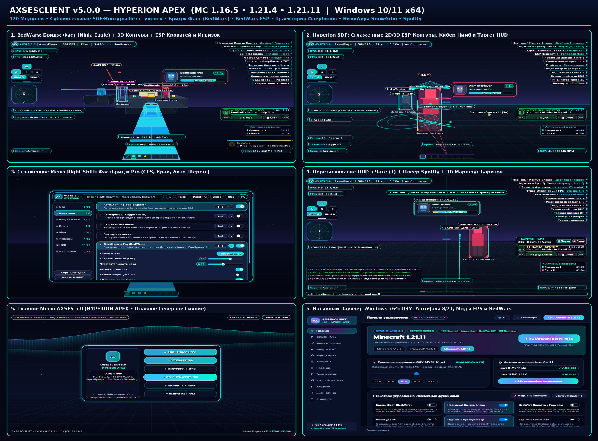

# AXSESCLIENT v5.0.0 — HYPERION APEX

**Нативный Windows 10/11 x64 лаунчер (`AXSESCLIENT.exe`), менеджер популярных модов (`Sodium` / `Lithium` / `Baritone`) и Fabric-клиент для Minecraft `1.16.5`, `1.21.4` и `1.21.11` (120 рабочих модулей • Субпиксельные сглаженные SDF-контуры • ФастБридж для BedWars • BedWars ESP и Фаерболы • Перемещение HUD в Чате • Плеер Spotify • КиллАура v4 `SnowGrim`/`Grim`/`Matrix` • 14 тем • RU/EN).**

## Скачать готовый релиз (`axsesclient-v5.0.0`)
🔗 **GitHub Release:** https://github.com/egorbelovziiik-design/WinLauncher/releases/tag/axsesclient-v5.0.0

| Файл | Размер | SHA-256 | Назначение |
|---|---|---|---|
| `AXSESCLIENT-Setup.exe` | `42,022,566` байт | `8983a2fb429c43401797d126d5ff0e021411dfefe9ab9fad0f8f7ff6339560e7` | Официальный установщик Windows 10/11 x64 (Inno Setup 6, безопасное обновление без удаления миров и настроек) |
| `AXSESCLIENT.exe` | `45,593,350` байт | `de2f9dc45dca6ae5ee181a7258002acfa7702fbf2292d1e8407db47bfc4303ae` | Автономный нативный лаунчер C# / .NET 8 / Avalonia 11 (прямой запуск игры, Хаб модов + Baritone, честное `-Xmx` ОЗУ, авто-Java 8 и 21) |
| `AXSESCLIENT-1.16.5.jar` | `576,098` байт | `fbd26b4c7c232940aed8e5cdc0ed923dec7758350eb533cdb731eddfae29c13c` | Fabric-мод клиента для **Minecraft 1.16.5** (Java 8 bytecode `v52`) |
| `AXSESCLIENT-1.21.4.jar` | `583,310` байт | `9ae4839221b595da5c46b2cd6671e85737e43cbeab33f45024ae15bec6f9d4e8` | Fabric-мод клиента для **Minecraft 1.21.4** (Java 21 bytecode `v65`) |
| `AXSESCLIENT-1.21.11.jar` | `584,855` байт | `a436fcdc0ca56cd21f44c34606ca5ce9a6b93312c9b6741f979a6ad01dc648a3` | Fabric-мод клиента для **Minecraft 1.21.11** (Java 21 bytecode `v65`) |

## Ключевые обновления `v5.0.0 (HYPERION APEX)`
- **Плавные сглаженные кастомные контуры `Hyperion SDF` (никаких «ванильных» ступенек и рваных углов)**:
  - В `RenderAdapter` и во всех трёх адаптерах (`1.16.5`, `1.21.4`, `1.21.11`) внедрён физический субпиксельный режим `beginHiDpiSubPixel()` / `endHiDpiSubPixel()` (компенсирующий `guiScale` до `1x1` физического пикселя монитора), Евклидово SDF-сглаживание углов `1.15px`, двухцветные градиентные рамки `drawGradientRoundedOutline`, сглаженные наклонные линии `drawLine` с отсечением Лянга–Барски и неоновые 3D-призмы `draw3dNeonPrism`.
  - Новый стиль боксов по умолчанию в `Entity ESP` — **`Гиперион Неон (Hyperion Neon)`** с плавным переходом цветов, мягким свечением и скруглёнными полосками ХП/брони.
- **Скоростная простройка `ФастБридж Pro (FastBridge)` для BedWars и SkyWars**:
  - **4 режима**: **`Ниндзя Игл`** (авто-присед ровно на краю блока над бездной и мгновенный подъём после клика), **`ГодБридж 75.6`**, **`Бризли Фаст`** и **`СейфБридж`**.
  - **Авто-слот шерсти** (автопереключение на полный стак шерсти/блоков в хотбаре), **стабилизация угла `76°`** с шагом мыши `GCD`, **3D неоновый контур следующего блока** и живой HUD скорости постройки (`бл/с` + запас блоков).
- **Богатый пакет модулей для BedWars, PvP и визуала (`120` функций всего)**:
  - **`Неоновый Контур Блоков (Block Contour Pro)`** — заменяет ванильную тонкую чёрную сетку блока на двойной сглаженный 3D-контур Hyperion с подсветкой активной грани.
  - **`БедВарс ESP и Кровати (BedWars ESP)`** — 3D-подсветка кроватей с определением типа застройки (`Обсидиан` / `Эндерняк` / `Доски` / `Шерсть` / `ОТКРЫТА`) + подсветка и живой счётчик железа, золота, алмазов и изумрудов.
  - **`Защита от Фаерболов и ТНТ (Fireball & TNT Shield)`** — плавная 3D-траектория полёта фаерболов, ТНТ, стрел и перлов, круг взрыва и **авто-отбитие фаерболов** ударом.
  - **`Авто-Инструмент и Меч`**, **`Авто-Клатч на Стену (Bridge Clutch)`**, **`Детектор Инвизок и Угроз`** (`👻 ИНВИЗКА! ТНТ`) и **`Неоновый Шлейф и Кибер-Нимб`**.
- **Все флагманские возможности `v4.0` сохранены**:
  - Перемещение любых HUD-виджетов прямо в Чате (`T`), живой плеер **Spotify** с авто-стопом музыки Minecraft, **КиллАура v4** (`SnowGrim`, `Grim`, `Matrix`, `Vulcan`, `Intave`, `Polar`) и встроенный в лаунчер **Хаб модов FPS + Baritone**.
