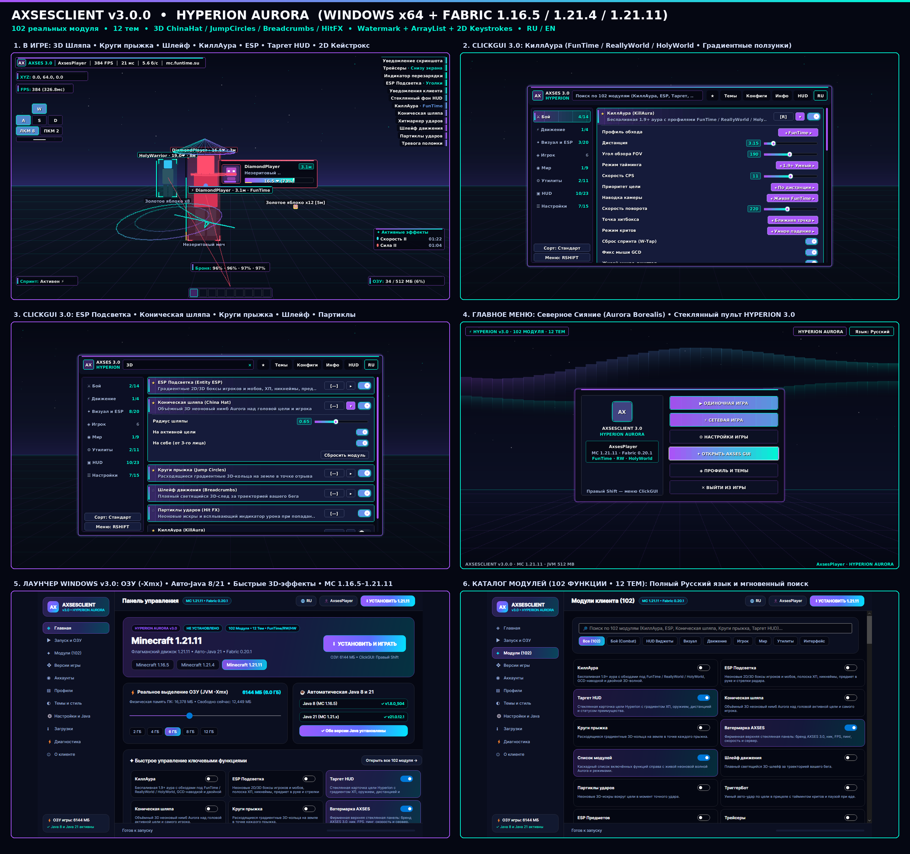

# AXSESCLIENT v3.0.0 — HYPERION AURORA

**Нативный Windows 10/11 x64 лаунчер (`AXSESCLIENT.exe`) и Fabric-клиент для Minecraft `1.16.5`, `1.21.4` и `1.21.11` (102 реальных модуля • 12 тем • Русский / English).**

## Скачать готовый релиз (`axsesclient-v3.0.0`)
🔗 **GitHub Release:** https://github.com/egorbelovziiik-design/WinLauncher/releases/tag/axsesclient-v3.0.0

| Файл | Назначение |
|---|---|
| `AXSESCLIENT-Setup.exe` | Официальный установщик Windows 10/11 x64 (Inno Setup 6, безопасное обновление без удаления миров и скриншотов) |
| `AXSESCLIENT.exe` | Автономный нативный лаунчер C# / .NET 8 / Avalonia 11 (прямой запуск игры, честное выделение `-Xmx` ОЗУ, авто-установка Java 8 и Java 21) |
| `AXSESCLIENT-1.16.5.jar` | Fabric-мод клиента для **Minecraft 1.16.5** (Java 8 bytecode `v52`) |
| `AXSESCLIENT-1.21.4.jar` | Fabric-мод клиента для **Minecraft 1.21.4** (Java 21 bytecode `v65`) |
| `AXSESCLIENT-1.21.11.jar` | Fabric-мод клиента для **Minecraft 1.21.11** (Java 21 bytecode `v65`) |

## Ключевые возможности `v3.0.0 (HYPERION AURORA)`
- **102 рабочих модуля и 12 встроенных тем** (`HYPERION AURORA`, `HYPERION DARK`, `CRIMSON ECLIPSE`, `SAKURA GLOW`, `IMPERIAL GOLD` и др.).
- **Новые 3D-эффекты и HUD-виджеты**:
  - **Коническая шляпа (`China Hat`)** — вращающийся полупрозрачный 3D-нимб Aurora над целью и игроком.
  - **Круги прыжка (`Jump Circles`)** — расходящиеся двойные градиентные 3D-кольца на земле при прыжке.
  - **Шлейф движения (`Breadcrumbs`)** и **Партиклы ударов (`Hit Particles`)**.
  - **Ватермарка AXSES 3.0 (`Watermark HUD`)**, каскадный **Список модулей (`Module ArrayList`)** с живой волной Aurora, **2D Кейстрокс (`WASD + CPS + Пробел`)** и карточка **Активные эффекты**.
- **Боевая система и ESP**:
  - **КиллАура (`FunTime` / `ReallyWorld` / `HolyWorld` / `SpookyTime` / `Legit`)** с плавной S-кривой наводки, фиксом мыши GCD, умными критами, `W-Tap` и двойным 3D-кольцом Jello Wave.
  - **ESP Подсветка (`Entity ESP`)**, **ESP Предметов (`Item ESP`)**, **Трейсеры (`Tracers`)** и обновлённый **Таргет HUD Hyperion**.
- **Главное меню «Северное Сияние» (`Aurora Borealis`)**, **ClickGUI 3.0 (`Right Shift`)** и **Редактор HUD 3.0** с фильтром активных виджетов и привязкой по сетке.
